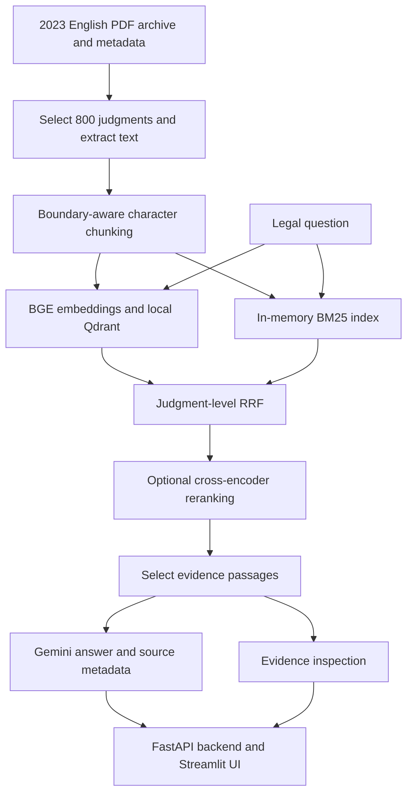

# Evaluation-driven Supreme Court RAG

A locally implemented and evaluated retrieval-augmented generation system over **800 selected English Indian Supreme Court judgments from 2023**. It combines legal-document retrieval, evidence inspection, Gemini-based synthesis, and saved-artifact evaluation.

**Main finding:** Hybrid RRF achieved the highest held-out **nDCG@5 (0.8178)** and **strict pooled Recall@5 (0.6710)** among five tested retrieval configurations. Cross-encoder reranking did not outperform it. A separate human A/B answer assessment reached a scoring ceiling and measured **no difference** between answer configurations.

This is an experimental research aid—not legal advice, a production deployment, or a demonstrated legally reliable system. See the [final technical report](reports/final_technical_report.md) for methodology, statistical qualifications, artifact references, and resume-safe summaries.

## Problem and capabilities

Legal research requires finding the relevant judgment and the passage supporting a specific proposition—not merely producing plausible text.

- Compare dense search, BM25, judgment-level hybrid fusion, and cross-encoder reranking.
- Inspect case metadata and retrieved passages independently of generation.
- Generate answers using the official Google GenAI SDK, with an opt-in source-ID reference contract.
- Evaluate saved rankings against graded relevance labels without rerunning retrieval.
- Review paired answers using randomized A/B presentation, blank review templates, provenance checks, and reproducible score aggregation.

## Architecture



Dense-only and BM25-only modes bypass fusion; plain Hybrid RRF bypasses reranking.

| Component | Implementation |
|---|---|
| Data processing | Python, `pandas`, `pyarrow`, `pypdf` |
| Embeddings | FastEmbed, `BAAI/bge-small-en-v1.5`, 384 dimensions |
| Dense storage | Local Qdrant; `supreme_court_2023`; cosine similarity |
| Sparse retrieval | `rank-bm25` / `BM25Okapi` |
| Fusion | Equal-weight judgment-level RRF, constant `k=60` |
| Reranker | `Xenova/ms-marco-MiniLM-L-6-v2` through FastEmbed |
| Generation | Gemini through `google-genai` |
| Application and review | FastAPI, Streamlit, `requests`, `openpyxl`, `unittest` |

### Verified corpus and retrieval configuration

| Property | Value |
|---|---:|
| Selected judgments | 800 |
| Extracted text characters | 40,673,343 |
| Stored chunks / persisted Qdrant points | 21,451 / 21,451 |
| Nominal chunk window / overlap | 2,200 / 250 characters |
| Initial candidates | Up to 50 chunks per dense/BM25 branch |
| Reranker input | Up to 20 fused judgments; first 1,200 characters per representative passage |
| Default returned evidence | Up to 5 judgments; API/UI configurable from 1 to 10 |

Chunking searches for newline, paragraph, period-space, and semicolon-space boundaries; it is not token-based or legal-section parsing. Counts were checked against `data/judgments.jsonl`, `data/chunks.jsonl`, and the persisted Qdrant database without rebuilding the index.

## Retrieval evaluation

Relevance labels are **0 = irrelevant, 1 = partially relevant, 2 = strongly relevant**. Lenient relevance counts labels ≥1; strict relevance counts label 2. Recall is against the **reviewed candidate pool**, not all relevant judgments in the corpus. nDCG uses graded relevance.

### Frozen held-out retrieval benchmark

**H01–H30; 30 queries × 5 configurations = 150 ranking records; 292 unique reviewed query–judgment pairs.**

| Retrieval method | nDCG@5 | Lenient pooled Recall@5 | Strict pooled Recall@5 |
|---|---:|---:|---:|
| Dense | 0.7292 | 0.5525 | 0.5990 |
| BM25 | 0.7988 | 0.5544 | 0.6509 |
| **Hybrid RRF** | **0.8178** | **0.6138** | **0.6710** |
| Hybrid RRF + reranking | 0.7811 | 0.5789 | 0.5731 |
| BM25 + reranked fusion | 0.8043 | 0.5870 | 0.6534 |

Sources: [full saved metrics](reports/heldout_final_metrics_v1.json), [earlier summary](data/heldout_metrics_v1.json), [candidate rankings](data/heldout_eval_candidates_v1.jsonl), and `data/heldout_relevance_review_v1.xlsx`.

The fifth configuration is an **offline fusion experiment**, not an additional API mode. Paired bootstrap analysis uses 10,000 question resamples. The nDCG and strict-recall intervals comparing RRF with BM25, reranking, and fusion cross zero; no statistically significant superiority over those methods is claimed. Other intervals do exclude zero, so a blanket statement that *all* intervals cross zero is incorrect; the [technical report](reports/final_technical_report.md#10-held-out-retrieval-results-and-uncertainty) documents the distinction.

Development results on **Q01–Q30**, used for analysis and experimentation, are reported separately in the technical report. They are not held-out results. The H questions were subsequently reused to diagnose and develop answer grounding; their historical retrieval benchmark remains frozen, but they are **development questions for the answer comparison**.

## Human answer A/B assessment

The completed `data/answer_review_v1_v2_human_adjudication.xlsx` contains **30 pairs, 60 answers, and 180 completed scores** from one human evaluator. Both configurations use `gemini-3.1-flash-lite`, Hybrid RRF, five sources, and identical ordered retrieved evidence.

| Criterion | Answer A mean /2 | Answer B mean /2 | Difference |
|---|---:|---:|---:|
| Correctness | 2.00 | 2.00 | 0 |
| Citation support | 2.00 | 2.00 | 0 |
| Completeness | 2.00 | 2.00 | 0 |

Every pair ties on every criterion. This is a **ceiling effect, not evidence that V2 outperformed V1 or that arbitrary legal questions can be answered perfectly**. Review was excerpt-based; full-PDF verification, independent expert review, inter-rater agreement, and unseen-question performance are not established. Earlier AI-assisted draft scores are provisional and are not the final answer-quality metrics. The technical report provides a de-identified account of the saved assessment.

V2 adds source IDs, metadata, stronger evidence-use instructions, and membership checks. The validator returns `semantic_support_verified: false`: resolving an ID is **not proof that its passage supports the adjacent claim**.

## Docker stack

Docker packaging and a safe embedded-to-server Qdrant migration path are available in [DOCKER.md](DOCKER.md). Compose runs FastAPI, Streamlit, a private persistent Qdrant server, and a one-shot migration verifier. The original embedded index remains untouched. The application image builds successfully; API/UI health checks, all four retrieval modes, and a real Gemini request have passed. Client **1.17.1** is aligned with server **1.17.0**, and the 21,451 stored points were verified unchanged during the client update. Browser interaction and broader deployment acceptance remain separate checks. No production-deployment claim is made.

## Verified AWS serverless deployment

The project also has a verified AWS serverless **project API** deployment in the Free account plan. The CloudFormation stack `supreme-court-rag-demo` is `CREATE_COMPLETE` in `ap-southeast-2` (Sydney) and contains four resources: a Lambda execution role, Lambda function, IAM-authenticated Function URL, and CloudWatch log group. See [AWS_DEPLOYMENT.md](docs/AWS_DEPLOYMENT.md) for the resource inventory, commands, monitoring observations, and cleanup guidance.

The Function URL requires AWS Signature Version 4 authentication and is not anonymously accessible. Its verified `GET /health`, `GET /about`, and `GET /benchmark/summary` endpoints serve static metadata and recorded benchmark results only. They do not run Qdrant, dense/BM25 retrieval, Hybrid RRF, cross-encoder reranking, or Gemini generation; the complete RAG pipeline remains in local Docker Compose. This is not a production-hosted RAG engine or a legally validated service.

## Run locally

Run from the repository root using the existing Python environment. The inspected environment uses Python **3.13.1**.

```powershell
.\.venv\Scripts\Activate.ps1
python -m pip install -r requirements.txt
```

Installation is optional for an already provisioned environment. Dependencies are unpinned; `requirements.txt` does not explicitly include the corpus-processing dependencies `pandas`, `pyarrow`, and `pypdf`. Prepared `data/chunks.jsonl` and `qdrant_storage/` artifacts are required for live retrieval and are not guaranteed to be included in a source-only checkout.

In separate terminals, activate the environment and run:

```powershell
python -m uvicorn app:app --host 127.0.0.1 --port 8000
```

```powershell
python -m streamlit run frontend.py --server.port 8501
```

- UI: `http://127.0.0.1:8501`; API docs: `http://127.0.0.1:8000/docs`.
- `GET /health` reports engine initialization; `POST /api/retrieve` retrieves evidence without a Gemini key.
- `POST /api/query` generates answers; `GET /api/metrics` serves the **development** retrieval report, not the held-out table above.
- Keep `GEMINI_API_KEY` in a local environment or unshared `.env`. Generation sends questions/evidence to Google and is subject to provider cost and quotas. Model initialization may download weights.
- Use one backend process against local Qdrant storage; do not start multiple workers or retrieval CLIs against the same directory concurrently.

**Defaults are not the evaluated answer configuration:** the application still defaults to `hybrid_reranked`, `gemini-2.5-flash`, and V1. The saved A/B evaluation used explicit model/version settings and `hybrid_rrf`; no defaults were changed to match benchmark winners.

See [LOCAL_RUN.md](LOCAL_RUN.md) for historical launch/troubleshooting instructions. To run offline regression tests:

```powershell
python -B -m unittest discover -s tests -v
```

The [technical report](reports/final_technical_report.md#15-reproducibility-and-project-execution) explains how to verify saved metrics without overwriting them. Do not rerun candidate generation, workbook preparation, or corpus/index builders over frozen artifacts just to view results.

## Project structure

```text
build_corpus.py / chunk_corpus.py / embed_store.py  Corpus and indexing
query_pipeline.py / retrieve.py                   Retrieval engine and CLI
rag_engine.py / app.py / frontend.py              Generation, API and UI
eval.py / prepare_labels.py / prepare_heldout.py    Candidate and review preparation
calculate_metrics.py / calculate_heldout_metrics.py Saved-ranking evaluation
answer_evaluation.py                              API-based answer generation runs
prepare_human_adjudication.py                     Paired review preparation
calculate_human_adjudication.py                   Confirmed excerpt-review aggregation
experiments/                                     Offline fusion experiment
tests/                                           Offline regression tests
reports/                                         Historical evidence and final technical report
```

## Limitations

- Selected one-year English corpus; not comprehensive coverage or a current-law service.
- Only 30 held-out retrieval queries, shallow judged pools, and no demonstrated independent multi-reviewer agreement for relevance labels.
- Reranking lost relevant top-five judgments; longer-context explanations remain hypotheses, not proven causes.
- Single-reviewer, excerpt-based answer assessment with a ceiling effect and incomplete verification disclosures.
- Citation-membership parsing has coverage gaps and does not establish semantic entailment; abstention is largely prompt-driven.
- External generation is stochastic and quota-dependent. The verified AWS deployment is limited to a static project API; no production-grade availability, authentication/rate-limiting hardening, full-pipeline hosting, or legal-reliability claim is made.

Private review workbooks, reviewer-identifying outputs, and A/B assignment mappings remain local and are intentionally excluded from Git. The final technical report contains the de-identified review summary. Review preparation requires an explicit private coordinator `--seed`; never publish it or the generated mapping.

Historical reports, [PROJECT_STATUS.md](PROJECT_STATUS.md), and [EVAL_PROTOCOL.md](EVAL_PROTOCOL.md) are preserved. Some contain outdated plans, terminology, or reviewer-provenance claims; use the final technical report's discrepancy register when interpreting them.
