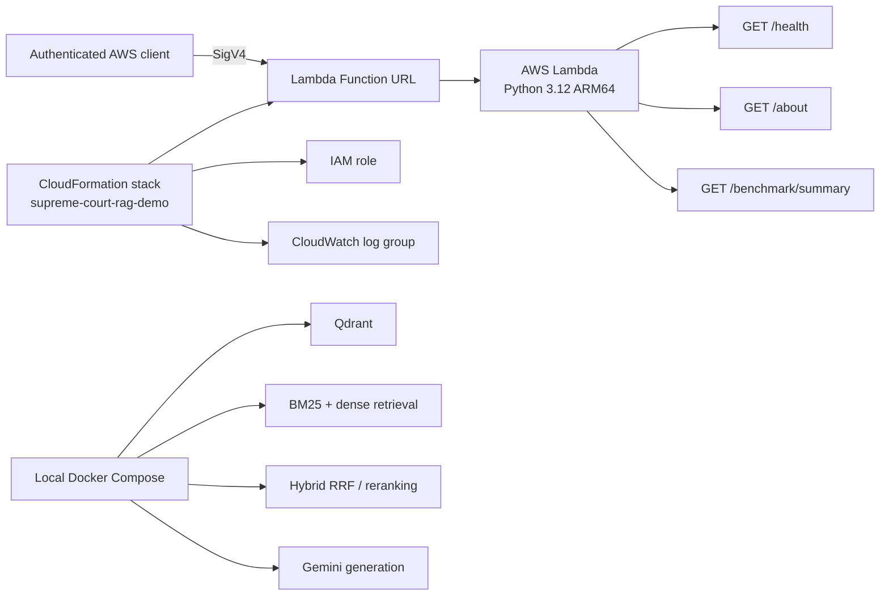

# AWS serverless deployment

This document records the verified deployment of the project's **static project
API**. It does not describe the local Docker Compose RAG runtime as an AWS
service, and it does not claim production-grade availability or legal
validation.

## Architecture

The complete retrieval-augmented generation pipeline remains in the local
Compose application. The AWS Lambda function exposes only project metadata and
recorded held-out benchmark results.



AWS does **not** run Qdrant, dense retrieval, BM25, hybrid RRF, cross-encoder
reranking, or Gemini generation for this deployment.

## AWS environment and resource inventory

| Property | Verified value |
|---|---|
| Account plan | Free account plan |
| Region | Asia Pacific (Sydney), `ap-southeast-2` |
| CloudFormation stack | `supreme-court-rag-demo` |
| Stack status | `CREATE_COMPLETE` |
| Resources deployed | 4 |

The four deployed resources are:

1. `DemoExecutionRole` — AWS Lambda execution IAM role
2. `DemoFunction` — AWS Lambda function
3. `DemoFunctionUrl` — AWS Lambda Function URL
4. `DemoLogGroup` — AWS CloudWatch Log Group

The deployed Lambda configuration is:

| Setting | Value |
|---|---|
| Runtime | Python 3.12 |
| Architecture | ARM64 |
| Memory | 128 MB |
| Timeout | 3 seconds |
| Function URL authentication | `AWS_IAM` |
| Reserved concurrency | Not configured |
| CloudWatch log retention | 3 days |

The repository does not currently contain the CloudFormation template or an
AWS deployment script. The inventory and configuration above are the verified
deployed values; this document is not an infrastructure-as-code replacement.

### Deployment notes

The verified deployment is region-scoped to `ap-southeast-2` (Sydney); all
inspection and cleanup commands in this document therefore pass that region
explicitly. No other region is represented as a verified deployment target.

No reserved concurrency is configured on the function. The available
deployment record does not include a separate concurrency incident or a
resolution procedure, so this documentation does not invent one. If a
concurrency limit is required later, it must be changed and verified through
the deployed CloudFormation stack rather than assumed from this record.

### CloudFormation process

The stack was created from a CloudFormation template in the deployment
environment and then verified with `describe-stacks` and
`list-stack-resources`. That template is not tracked in this repository, so
the exact create/update command and template contents cannot be reproduced
here without inventing infrastructure details. The repository intentionally
does not modify or recreate the deployed stack. The read-only inspection
commands below are the supported verification path for this checkout.

## Function URL and authentication

Function URL:

<https://supfsgccxnj2jvslrlus5yawri0pggju.lambda-url.ap-southeast-2.on.aws/>

The URL requires AWS Signature Version 4 authentication because its
`AuthType` is `AWS_IAM`. It is not anonymously accessible. A caller needs AWS
credentials with permission to invoke the function URL and must sign each
request; credentials, tokens, account IDs, and secret material must not be
placed in this repository.

## Verified endpoints

| Endpoint | Purpose | Verified result |
|---|---|---|
| `GET /health` | Health status and region | HTTP 200 |
| `GET /about` | Project metadata and architecture | HTTP 200 |
| `GET /benchmark/summary` | Held-out benchmark metrics | HTTP 200 |

These endpoints serve static project metadata and recorded benchmark results
only. They do not execute vector retrieval, BM25 retrieval, hybrid RRF,
cross-encoder reranking, Gemini generation, or Qdrant queries. The full RAG
pipeline remains in the local Docker Compose application.

## Held-out benchmark results

The AWS summary preserves the existing evaluation values:

| Method | nDCG@5 | Lenient Recall@5 | Strict Recall@5 |
|---|---:|---:|---:|
| Dense | 0.7292 | 0.5525 | 0.5990 |
| BM25 | 0.7988 | 0.5544 | 0.6509 |
| Hybrid RRF | 0.8178 | 0.6138 | 0.6710 |
| Hybrid Reranked | 0.7811 | 0.5789 | 0.5731 |
| BM25 + Reranked Fusion | 0.8043 | 0.5870 | 0.6534 |

Benchmark scope: 30 held-out queries, 292 unique pooled
query–judgment candidates, 800 Supreme Court judgments, and 21,451 chunks.
These are benchmark-specific results. Pooled recall depends on the reviewed
candidate pool; there was no independent legal validation; and cross-encoder
reranking did not improve upon Hybrid RRF in this evaluation.

## Deployment and verification commands

The following commands inspect the existing stack and deployed resources. They
use the Sydney region explicitly and do not print credentials.

```powershell
aws cloudformation describe-stacks `
  --stack-name supreme-court-rag-demo `
  --region ap-southeast-2 `
  --query "Stacks[0].{Name:StackName,Status:StackStatus}"

aws cloudformation list-stack-resources `
  --stack-name supreme-court-rag-demo `
  --region ap-southeast-2

aws lambda list-functions `
  --region ap-southeast-2 `
  --query "Functions[?contains(FunctionName, 'supreme')].{Name:FunctionName,Runtime:Runtime,Arch:Architectures,Memory:MemorySize,Timeout:Timeout}"
```

For an authenticated request, use a configured AWS CLI profile or equivalent
credential provider and let the AWS tooling create the Signature Version 4
signature. Do not substitute anonymous `curl` for this check. The exact
function name can be obtained from the stack resource list:

```powershell
aws cloudformation describe-stack-resources `
  --stack-name supreme-court-rag-demo `
  --region ap-southeast-2 `
  --query "StackResources[?ResourceType=='AWS::Lambda::Function'].PhysicalResourceId"
```

The AWS CLI can invoke the Lambda directly after the function name is known:

```powershell
aws lambda invoke `
  --function-name <function-name-from-stack> `
  --region ap-southeast-2 `
  --payload "{}" `
  response.json
```

Function URL requests must be signed with SigV4 by the chosen client. Do not
record the response file if it contains credentials or other sensitive
request metadata.

## CloudWatch monitoring

Verification observed three Lambda invocations. The `Errors` metric was `0`
for the observed datapoints, and `Throttles` was `0` for the observed
datapoints. The CloudWatch log group exists with 3-day retention.

No log events appeared during the initial inspection because Lambda
system/application logging was configured at `WARN` level. This does not prove
zero errors for all time and is not comprehensive validation of log monitoring.

Example read-only checks:

```powershell
aws cloudwatch list-metrics `
  --namespace AWS/Lambda `
  --dimensions Name=FunctionName,Value=<function-name-from-stack> `
  --region ap-southeast-2

aws logs describe-log-groups `
  --log-group-name-prefix /aws/lambda/ `
  --region ap-southeast-2 `
  --query "logGroups[].{Name:logGroupName,Retention:retentionInDays}"
```

## Cost, lifecycle, and cleanup

This deployment uses the AWS Free account plan. Free-plan eligibility,
remaining credits, quotas, and actual usage must be checked in AWS Billing.
The plan has expiration or credit-exhaustion limitations; do not promise
permanent free hosting or zero charges. The live endpoint may not remain
available after the plan expires. The GitHub documentation and code remain
independently available.

When the deployment is no longer needed, remove the CloudFormation stack only
after confirming that it contains no resources needed by another workload:

```powershell
aws cloudformation delete-stack `
  --stack-name supreme-court-rag-demo `
  --region ap-southeast-2

aws cloudformation wait stack-delete-complete `
  --stack-name supreme-court-rag-demo `
  --region ap-southeast-2
```

Deletion is irreversible for the stack's managed resources. Check AWS Billing
after cleanup for any remaining charges or unrelated resources.

## Resume-ready description

> Deployed an IAM-authenticated serverless project API on AWS Lambda using
> CloudFormation, with CloudWatch monitoring to expose benchmark results from
> an evaluation-driven legal RAG system over 800 Indian Supreme Court
> judgments.

This wording intentionally does not claim AWS deployment of Qdrant, Gemini, or
the full RAG pipeline.
