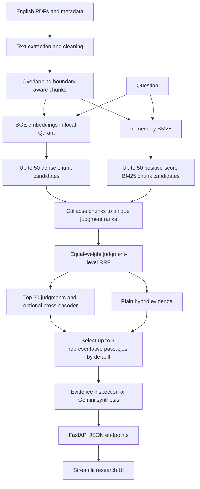

# Final technical report: evaluation-driven Supreme Court RAG

**Scope:** locally implemented and evaluated legal-document RAG; documentation consolidation as of November 2, 2026.

This report distinguishes implementation facts, frozen retrieval results, development experiments, and a single-reviewer answer assessment. It does not claim production deployment, legal reliability, or a statistically significant overall improvement. Historical artifacts remain unchanged.

## 1. Executive summary

The project implements corpus preparation, dense and lexical search, judgment-level rank fusion, optional cross-encoder reranking, Gemini answer generation, and a FastAPI/Streamlit research interface over 800 selected English Supreme Court judgments from 2023.

Direct verification found **40,673,343 extracted text characters**, **21,451 unique chunks**, and **21,451 persisted Qdrant points**. Retrieval evaluation uses graded relevance judgments and saved rankings rather than rerunning models to reproduce results.

The frozen held-out retrieval benchmark contains **30 questions, five configurations, 150 ranking records, and 292 reviewed query–judgment pairs**. Hybrid RRF has the highest point estimates for nDCG@5 (**0.8178**), lenient pooled Recall@5 (**0.6138**), and strict pooled Recall@5 (**0.6710**). Reranking does not outperform it. Uncertainty must be reported per comparison; the results do not establish universal or blanket statistically significant superiority.

A separate answer A/B assessment contains **30 development pairs, 60 answers, and 180 completed scores**. Both configurations receive 2/2 on correctness, citation support, and completeness for every question. This is a **ceiling-effect result with no observed difference**, not evidence of perfect legal accuracy or V2 improvement. The evaluator confirmed personal assessment; the workbook records excerpt-based review, not demonstrated full-judgment verification or independent expert double review.

## 2. Motivation and problem formulation

Legal retrieval must distinguish a specific issue, statutory provision, procedural posture, and judicial holding from superficially similar text. Fluent synthesis alone is insufficient: an answer can cite a real judgment while attributing an unsupported proposition to it.

The engineering questions are:

1. Which of dense search, BM25, hybrid fusion, and reranking best ranks relevant judgments within this selected corpus?
2. How do offline retrieval changes behave on separate saved question sets?
3. Can generated propositions be traced to supplied evidence, and what does that traceability actually establish?
4. What can a limited answer-review protocol demonstrate without overstating generalization or legal correctness?

The retrieval target is a **unique judgment**. Text chunks supply its representative evidence. The answer target is an evidence-bounded response to a question, not a definitive statement of all applicable or current Indian law.

## 3. Corpus acquisition and preprocessing

The source is the [Indian Supreme Court judgments archive](https://github.com/vanga/indian-supreme-court-judgments), accessed through its 2023 metadata and English PDF archive.

| Stage | Actual implementation | Artifact |
|---|---|---|
| Metadata inspection/acquisition | [inspect_dataset.py](../inspect_dataset.py) reads/downloads 2023 Parquet metadata | `data/metadata_2023.parquet` |
| English PDF index | [inspect_pdf_index.py](../inspect_pdf_index.py) downloads the archive index | `data/english_2023_index.json` |
| Selection and extraction | [download_pdfs.py](../download_pdfs.py) matches metadata paths to PDF stems, deterministically samples up to 800 matching rows, downloads the English archive if absent, and extracts selected PDFs | `data/selected_metadata.parquet`, `data/pdfs/` |
| Text extraction | [build_corpus.py](../build_corpus.py) uses `pypdf.PdfReader` and joins page text with double newlines | `data/judgments.jsonl` |

Cleaning removes NULs, normalizes line endings, collapses repeated horizontal whitespace and excessive blank lines, and strips surrounding whitespace. Records with fewer than 500 cleaned characters are skipped. The pipeline does **not** implement OCR, semantic paragraph detection, automatic holding/submission classification, or comprehensive header/footer removal.

### Directly verified corpus statistics

| Property | Verified value | Verification source |
|---|---:|---|
| Judgment records / unique IDs | 800 / 800 | `data/judgments.jsonl` |
| Year metadata | 2023 for all 800 records | `data/judgments.jsonl` |
| Extracted characters | 40,673,343 | Sum of each stored judgment's `text` length |
| Chunk records / unique IDs | 21,451 / 21,451 | `data/chunks.jsonl` |
| Judgments represented in chunks | 800 | Unique chunk `doc_id` values |
| Persisted vector points | 21,451 | Read-only count in the collection's local SQLite `points` table |

The selected subset is not the complete Court corpus. Metadata availability is not an independent legal-authenticity check. Extracted text is retained without page/paragraph offsets suitable for automatic claim-level citation verification.

## 4. Chunking and embedding strategy

[chunk_corpus.py](../chunk_corpus.py) implements boundary-aware **character windows**, not token windows:

- `CHUNK_SIZE = 2200` characters.
- `OVERLAP = 250` characters before surrounding-whitespace stripping.
- For a nonfinal window, search its latter portion, starting at 65% of the window, for `\n\n`, `\n`, `. `, and `; `.
- Choose the latest candidate position across all four separators, not a paragraph-first hierarchy. Use it only when it lies strictly beyond the search's minimum position.
- Slice through `boundary + 1`, strip the text, and emit slices of at least 100 characters.
- Advance to `max(end - OVERLAP, start + 1)`.

Stored chunk lengths range from **259 to 2,199 characters**. Boundary selection and trimming explain why the nominal window/overlap should not be described as exact visible chunk lengths. An in-memory reconstruction of the splitting function reproduced all saved chunk IDs and texts without rerunning the writer.

[embed_store.py](../embed_store.py) embeds chunk text using FastEmbed's **`BAAI/bge-small-en-v1.5`**, with **384 dimensions** and indexing batches of **32**. Point IDs are deterministic UUIDs derived from `chunk_id`; the chunk metadata/text is retained as payload. No embedding-model tuning was performed for this consolidation.

## 5. Vector and sparse indexing

### Dense index

The collection is **`supreme_court_2023`**, persisted under `qdrant_storage/`, configured for **cosine** similarity and 384-dimensional vectors. Both code and stored collection metadata agree.

A read-only SQLite connection using `mode=ro&immutable=1` verified the stored point count. The database hash was unchanged before and after inspection. This verifies persistence/count, not that every vector was independently regenerated and compared to its source text.

The index builder skips reconstruction when its point count matches the chunk count; it does not verify content or model hashes. A count mismatch can trigger collection deletion/rebuilding. It is therefore a construction tool, not a safe read-only audit command.

### Lexical index

[query_pipeline.py](../query_pipeline.py) loads all chunks and builds an in-memory `rank_bm25.BM25Okapi` index. Its tokenizer lowercases text and extracts `[a-z0-9]+`; there is no project-level stemming, lemmatization, or stop-word pipeline. BM25 scoring parameters are left at dependency defaults rather than explicitly tuned.

No dense/BM25 score calibration or raw-score averaging is used. The hybrid path combines **ranks**.

## 6. Retrieval architecture and evidence selection



The four runtime modes are `dense`, `bm25`, `hybrid_rrf`, and `hybrid_reranked`. Dense-only and BM25-only modes deduplicate judgments and bypass fusion/reranking.

Judgment identity prefers `doc_id`, then `source_pdf`, then `case_name`. The shared engine takes up to **50 chunk candidates per branch**. Fifty chunks can correspond to fewer than fifty judgments. BM25 omits nonpositive-score results.

The default evidence count is **five judgments**, configurable from **one to ten** through the API/UI. Actual result lists can be shorter: the held-out Dense H19 ranking has only four judgments. Evaluation still uses a cutoff of five rather than inventing a fifth result.

Fusion retains the first representative record encountered for a judgment, processing dense results before BM25. It does not aggregate multiple evidence passages; a dense-selected passage can remain the representative even when BM25 matched another passage in the same judgment.

## 7. RRF, reranking, and fusion experiments

### Judgment-level Reciprocal Rank Fusion

For each retrieval list, the implementation removes duplicate judgments and assigns consecutive unique-judgment ranks. It then computes:

```text
RRF(d) = sum over contributing lists of 1 / (60 + unique_judgment_rank(d))
```

The exact fusion constant is **60**, with equal contributions from dense and BM25 rankings. Scores are accumulated after judgment collapse, not per duplicate chunk.

### Cross-encoder reranking

The implemented model is **`Xenova/ms-marco-MiniLM-L-6-v2`**, via FastEmbed's `TextCrossEncoder`. The reranked path takes the first **20 RRF judgments**, scores only the first **1,200 characters** of each representative passage, sorts by cross-encoder score, and returns the requested evidence count. Scores are not documented probabilities.

### Fifth, offline configuration

[experiments/bm25_reranker_fusion.py](../experiments/bm25_reranker_fusion.py) fuses the persisted **top-five BM25** and **top-five hybrid-reranked** judgment lists with `1/(60+rank)`, deduplicates by `doc_id`, and breaks score ties by `doc_id`. This is distinct from dense+BM25 RRF and is **not exposed as a fifth API option**.

Only this controlled fusion experiment is recorded as executed in [retrieval_experiments.md](retrieval_experiments.md). Longer-context reranking and candidate-depth sweeps were considered but deferred. The saved experiment did not change application defaults. Its development advantage did not translate into the best held-out point estimate.

## 8. Answer generation and source-grounding approach

[rag_engine.py](../rag_engine.py) uses the official **`google-genai`** SDK. Current generation code sets temperature **0.2** and maximum output tokens **3,000**. It adds a zero thinking budget only when the selected model matches the engine's configured model; per-request model overrides follow a different configuration branch.

| Setting | Current application default | Saved V1/V2 answer assessment |
|---|---|---|
| Retrieval | `hybrid_reranked` | `hybrid_rrf` |
| Number of sources | 5 | 5 |
| Model | `gemini-2.5-flash` | `gemini-3.1-flash-lite` |
| Answer contract | V1 | V1 compared with V2 |

These defaults were **not** changed after observing benchmark results. The obsolete model name in the module header is not the executable default.

### V1

V1 requests answers restricted to supplied judgment extracts, case-name/SCR citations, key legal tests, and abstention when evidence is insufficient. These are generation instructions, not deterministic enforcement of legal support. Historical V1 answer records lack explicit version tags; their version is inferred from baseline provenance and schema.

### V2

V2 adds request-local `[S1]`, `[S2]`, etc. identifiers and source records containing judgment identity, case name, citation, date, excerpt, rank, score, and PDF metadata. Its prompts emphasize the exact question, holding-versus-submission attribution, statutory/procedural scope, exceptions, missing legal elements, and claim-adjacent source references. V2's prompt formatting also includes retrieval rank/score. Thus the intervention is a bundle of instructions, formatting, and traceability changes—not an isolated prompt sentence.

The source-reference validator checks recognized IDs for membership and malformed syntax, returning **`semantic_support_verified: false`**. It does not prove entailment, verify legal reasoning, or ensure each material proposition has a supporting citation. Its parser can miss grouped references containing whitespace, such as `[S1, S2]`; an answer with no recognized references can receive `valid`. Invalid membership results are returned as metadata rather than blocking the answer.

Both versions return metadata for all supplied evidence, not only sources actually cited. API retrieval excerpts are capped at **1,800 characters**; citation previews at **350 characters plus an ellipsis**. The answer evaluator passes persisted retrieval excerpts back into generation, so direct generation on full chunk text is not an identical evidence condition.

### Local application

[app.py](../app.py) provides `/health`, `/api/retrieve`, `/api/query`, and `/api/metrics`. [frontend.py](../frontend.py) implements separate answer-generation, evidence-inspection, and saved-metric views. Models/indexes initialize once per backend process.

The metrics endpoint displays the **development** benchmark. The API returns complete JSON responses; the engine's streaming helper is not exposed as a streaming HTTP route. Caller-supplied evidence can bypass retrieval without independent corpus-provenance validation. Authentication/rate limiting and a deployment architecture are not established by this implementation.

## 9. Evaluation design and relevance rubric

### Separate evaluation roles

| Evaluation | Questions | Configurations / answers | Reviewed units | Interpretation |
|---|---|---:|---:|---|
| Development retrieval | Q01–Q30 | Four baseline methods; separate fusion experiment | 280 unique query–judgment pairs | Analysis and experimentation |
| Frozen held-out retrieval | H01–H30 | Five methods; 150 ranking records | 292 unique query–judgment pairs | Historical retrieval benchmark |
| Human answer A/B | H01–H30 reused | Two configurations; 60 answers | 180 criterion scores | Development comparison after earlier failures informed V2 |

The retrieval H benchmark is retained as the historical held-out retrieval result. Its later use in answer-failure analysis means the same questions are **not an untouched answer-generation test**. No new retrieval tuning or ranking regeneration was performed for this report.

### Relevance labels

| Label | Retrieval interpretation |
|---:|---|
| 0 | Irrelevant to the specific question |
| 1 | Partially relevant: related context/principles without a direct substantive answer |
| 2 | Strongly relevant: directly and substantively addresses the question |

The judged pool is the deduplicated union of method top-five results, keyed by `(question_id, doc_id)`. The held-out workbook has **59 label-0, 91 label-1, and 142 label-2 pairs**, totaling 292; every evaluated top-five candidate has a label. The records are described as human-assigned in benchmark documentation, but reviewer identity, independent double annotation, and agreement are not established by the stored relevance fields alone.

### Metrics

- **Hit@5:** whether at least one relevant judgment appears by rank five.
- **Pooled Recall@5:** retrieved relevant judgments divided by relevant judgments in that question's reviewed pool.
- **MRR@5:** reciprocal rank of the first relevant judgment, or zero if absent.
- **nDCG@5:** graded gain `2^label - 1`, logarithmic rank discount, normalized by the ideal ordering of the full judged pool.

Lenient relevance is label ≥1; strict relevance is label 2. Metrics are macro-averaged over questions. Strict-zero pools contribute zero strict recall: Q04, Q07, Q17, Q30 in development, and H26 in held-out. This convention affects the interpretation of strict averages. Labels outside the reviewed pool remain unknown.

## 10. Held-out retrieval results and uncertainty

Primary sources:

- [data/heldout_eval_candidates_v1.jsonl](../data/heldout_eval_candidates_v1.jsonl): 150 question-method ranking records.
- `data/heldout_relevance_review_v1.xlsx`: 292 unique graded labels and review notes.
- [reports/heldout_final_metrics_v1.json](heldout_final_metrics_v1.json): complete summary, per-question scores, strict metrics, and paired intervals.
- [data/heldout_metrics_v1.json](../data/heldout_metrics_v1.json): earlier four-metric summary, without strict metrics or bootstrap details.

| Retrieval method | nDCG@5 | Lenient pooled Recall@5 | Strict pooled Recall@5 |
|---|---:|---:|---:|
| Dense | 0.7292 | 0.5525 | 0.5990 |
| BM25 | 0.7988 | 0.5544 | 0.6509 |
| **Hybrid RRF** | **0.8178** | **0.6138** | **0.6710** |
| Hybrid RRF + reranking | 0.7811 | 0.5789 | 0.5731 |
| BM25 + reranked fusion | 0.8043 | 0.5870 | 0.6534 |

All table values were checked against the full machine-readable report. Its overlapping summary fields match the earlier JSON. Independent in-memory calculation from the saved candidates and workbook reproduced per-question and aggregate metrics without retrieval inference.

**Finding:** Hybrid RRF has the highest nDCG and strict-recall point estimates among these five configurations. Reranking is a negative result relative to plain RRF here, not an improvement.

### Paired bootstrap

The saved procedure uses **10,000 paired question-level resamples**, with retrieval bootstrap seed **20261027**. Each draw samples 30 questions with replacement. Sorted resample means use positions 250 and 9750 for endpoints; the stored report rounds to four decimals. This is not the interpolated-percentile implementation used by the answer-comparison helper. No multiple-comparison adjustment is applied.

Differences below are **Hybrid RRF minus the comparator**, copied from `paired_bootstrap_comparisons`:

| Comparator | nDCG difference [95% interval] | Strict Recall difference [95% interval] |
|---|---|---|
| Dense | +0.0887 [0.0491, 0.1285] | +0.0720 [0.0233, 0.1243] |
| BM25 | +0.0191 [-0.0425, 0.0781] | +0.0201 [-0.0798, 0.1282] |
| Hybrid RRF + reranking | +0.0367 [-0.0342, 0.1106] | +0.0978 [-0.0019, 0.2039] |
| BM25 + reranked fusion | +0.0136 [-0.0493, 0.0776] | +0.0176 [-0.0731, 0.1159] |

The nDCG and strict-recall intervals against BM25, reranking, and fusion cross zero. There is no supported blanket significance claim over those alternatives. Conversely, **not all saved intervals cross zero**: the Dense intervals above exclude zero, and RRF–BM25 lenient recall is **+0.0594 [0.0033, 0.1244]**. All 28 saved comparison entries were reproducible from the persisted per-question values.

The historical [final_retrieval_comparison.md](final_retrieval_comparison.md) incorrectly groups BM25 lenient recall with zero-crossing intervals in its interpretation paragraph. Its numeric table is correct. This report preserves that artifact and states the discrepancy rather than repeating the prose. The stored metrics also describe intervals as descriptive on this small sample; this report does **not** promote them into a universal or unqualified statistical-superiority claim.

## 11. Development retrieval experiments

These results use **Q01–Q30**, not H01–H30.

| Retrieval method | Development nDCG@5 | Development lenient pooled Recall@5 |
|---|---:|---:|
| Dense | 0.7657 | 0.5723 |
| BM25 | 0.8521 | 0.6451 |
| Hybrid RRF | 0.8270 | 0.6264 |
| Hybrid RRF + reranking | 0.7944 | 0.6239 |
| Experimental BM25 + reranked fusion | 0.8591 | 0.6802 |

The four baseline rows come from [data/full_benchmark_metrics_v2.json](../data/full_benchmark_metrics_v2.json), `data/eval_candidates_v2.jsonl`, and `data/relevance_review_v2.xlsx`. The development pool has 280 labels: 96 irrelevant, 70 partial, and 114 strong. The [evaluation audit](evaluation_audit.md) records metric reproduction, complete top-five labeling, and no duplicate ranked judgments.

The fifth row is saved in [retrieval_experiments.md](retrieval_experiments.md) and is independently recoverable from [bm25_reranker_fusion_rankings.jsonl](bm25_reranker_fusion_rankings.jsonl) with the same development labels. Its MRR@5 is **0.9222**, below the reranked baseline's **0.9444**: development gains in one metric did not improve all metrics.

These experiments and analyses informed engineering interpretation. They are not the final generalization result, and the fusion method's development nDCG of 0.8591 must not be reported as held-out performance. The held-out fusion nDCG is 0.8043, below plain RRF's 0.8178.

## 12. Human answer A/B assessment

### Artifacts and comparability

- `data/answer_evaluation_3_1_flash_lite_v1.jsonl`.
- `data/answer_evaluation_3_1_flash_lite_v2_dev.jsonl`.
- `data/answer_review_v1_v2_human_adjudication.xlsx`.
- `reports/v1_v2_human_adjudicated_comparison.json` and `.md`.

Both runs contain exactly H01–H30, 30 successful nonempty answers, the model **`gemini-3.1-flash-lite`**, `hybrid_rrf`, and five sources. Entire ordered retrieval responses match for every pair. The paired workbook preserves the exact answers and common evidence. Version correspondence was checked privately; no assignment key, assignment seed, reviewer identity, or allocation is reproduced here.

The two answers were randomly assigned to A/B presentation. Blinding is best-effort: citation conventions and prior familiarity can reveal a version. The reviewer personally confirmed assessing all answers. This is **one evaluator's excerpt-based assessment**, not independent legal-expert validation or multiple-reviewer adjudication.

### Original answer rubric

| Criterion | Score 0 | Score 1 | Score 2 |
|---|---|---|---|
| Correctness | Materially wrong/unsupported | Partly correct or incomplete | Correct and grounded |
| Citation support | Cited case unsupported by retrieved excerpt | Partially supported/ambiguous | Directly supported |
| Completeness | Fails to address question | Partially addresses question | Sufficiently addresses question from evidence |

### Observed result

| Criterion | Answer A mean /2 | Answer B mean /2 | Difference |
|---|---:|---:|---:|
| Correctness | 2.00 | 2.00 | 0 |
| Citation support | 2.00 | 2.00 | 0 |
| Completeness | 2.00 | 2.00 | 0 |

All **180 scores are 2**; all **30 pairs tie on all three criteria**. Private version resolution gives the same V1/V2 means: 2.00 versus 2.00. Counts of improved/unchanged/degraded answers are **0 / 30 / 0** for each dimension. No V2 advantage was measured.

The 10,000-resample answer bootstrap yields difference intervals [0, 0] because all observed paired differences are zero. The degenerate interval is a property of these constant labels—not proof of equivalence, absence of real-world uncertainty, or perfect accuracy. The coarse rubric and observed rating ceiling do not distinguish configurations.

### Verification and provenance limits

All 60 recorded verification statuses specify retrieved-text excerpts. Page-reference fields contain a repeated generic chunk reference, not auditable full-PDF page/paragraph citations; the 150 source-level verification entries remain blank. Prior-exposure, conflict/unblinding, second-reviewer, disagreement-resolution, and workbook-sign-off disclosures are incomplete. Personal-review confirmation was recorded separately without fabricating missing workbook entries.

Therefore this result does **not** establish that every answer was checked against full judgments, that review was independent/double-blind, that reviewers agreed, or that unseen legal questions will receive similarly rated answers.

### Historical draft assessments are not final metrics

The earlier `data/answer_review_3_1_flash_lite_v1.xlsx`, `data/answer_review_3_1_flash_lite_v2_final_review.xlsx`, and `reports/v1_v2_answer_quality_comparison.md` contain **provisional AI-assisted draft assessments**. Their filenames and older descriptions do not establish independent human ground truth. They are preserved as history and are not used as final answer-quality metrics in this report.

The later maximum-score review does not, by itself, reconcile or disprove the concrete qualitative concerns recorded in the historical failure analysis. No new full-judgment adjudication was invented to resolve that disagreement.

## 13. Error analysis and engineering decisions

### Recorded retrieval findings

[retrieval_error_analysis.md](retrieval_error_analysis.md) and [retrieval_error_analysis.csv](retrieval_error_analysis.csv) analyze the **development** benchmark:

- **Reranking displacement:** 67 query–judgment occurrences in RRF's top five moved below reranked rank five; **43 were leniently relevant, including 25 strongly relevant**.
- **Graded-ranking and coverage losses:** reranking trails development BM25 by **0.0577 nDCG** and **0.0212 lenient recall**. Relative to RRF, its development nDCG drops **0.0326** and strict recall drops **0.0394**.
- **Topic-dependent behavior:** the report's topic tables show different outcomes across arrest, corruption, quashing, preventive detention, and other topics; the small per-topic samples do not support broad domain-wide claims.

The report does not contain an independently annotated failure-category taxonomy. These are observed ranking effects, not invented new labeled categories.

### Hypotheses remain hypotheses

The reranker sees only the first 1,200 characters of one representative passage. Missing later ratio/exception language and general-domain cross-encoder behavior are plausible explanations in the existing error analysis, but longer-context and model-domain comparisons were not completed. The measured degradation does not prove which mechanism caused it.

### Historical answer concerns

[answer_failure_analysis_3_1_flash_lite_v1.md](answer_failure_analysis_3_1_flash_lite_v1.md) records neighboring-question answers/missing tests, confusion between holdings and submissions or quoted lower-court reasoning, statutory-context overgeneralization, and claim/citation mismatch. This is a **historical, draft-review-based qualitative diagnosis**, not a new independently validated error-rate estimate. It motivated source/attribution discipline; the later ceiling-effect assessment does not empirically isolate which V2 changes helped.

The engineering decision supported by the results is to keep BM25/RRF as essential baselines and not assume an added reranker or more elaborate grounding contract automatically improves measured outcomes. The actual runtime defaults remain unchanged.

## 14. Limitations, validity threats, and discrepancy register

| Limitation or discrepancy | Consequence |
|---|---|
| Selected 2023 English corpus | No comprehensive, multilingual, historical, or current-law coverage claim |
| Only 30 held-out retrieval queries; top-five pooled labels | Relevant judgments outside the pool are unknown; pooled recall is not corpus recall |
| Relevance-label provenance does not establish independent double annotation | No inter-annotator agreement or independently adjudicated relevance-ground-truth claim |
| H questions reused for V2 answer development | Historical held-out retrieval results remain separate; answer results are development-only |
| One excerpt-based answer evaluator; ceiling effect | No measured V1/V2 difference, expert consensus, full-PDF validation, or general legal accuracy |
| Incomplete historical prompt/decoding/model-revision records | No isolated prompt-only causal attribution |
| Membership-only validation and parser coverage gaps | Source IDs do not prove semantic support; missing citations can evade checking |
| External Gemini behavior and provider quota | Generations can vary or fail; earlier runs record upstream 429 quota failures exposed as local 502 responses |
| Local Qdrant locking and eager model loading | One process should own storage; startup may load/download models even for lexical-only use |
| No verified production deployment/hardening | No Docker/AWS production, availability, latency, scalability, authentication, or legal-reliability claim |
| Unpinned dependencies; missing explicit preprocessing packages | A fresh installation is not an exact reconstruction of the evaluated environment |
| Earlier final retrieval prose overgeneralizes zero-crossing intervals | Use numeric `paired_bootstrap_comparisons`, not the incorrect blanket interpretation |
| `data/heldout_metrics_v1.json` lacks strict metrics and intervals | Use `reports/heldout_final_metrics_v1.json` for the complete held-out table |
| Historical status/protocol roadmaps and model descriptions are stale | Use executable constants and saved artifacts, not old plan labels or the model named in the generation-module header |
| Old answer reports call draft scores human-reviewed | Use the completed paired assessment with its actual, limited provenance; do not reuse draft gains as final results |

Historical documents are retained, not silently corrected or deleted. `PROJECT_STATUS.md` describes an earlier pilot phase; `EVAL_PROTOCOL.md` includes obsolete topic-to-ID assignments and future-work entries. The current relevance workbook generator targets `relevance_review_v2.xlsx`, despite earlier instructions naming the unversioned file. Some historical evaluator label loaders coerce values with `int()`; the actual labels were separately inspected for integer/range validity rather than assuming the loader proves annotation integrity.

## 15. Reproducibility and project execution

### Environment and setup

The inspected environment runs **Python 3.13.1**. Runtime dependencies are listed in [requirements.txt](../requirements.txt): FastEmbed, Qdrant client, rank-bm25, Google GenAI, openpyxl, FastAPI, Uvicorn, Streamlit, and requests. Corpus scripts additionally import `pandas`, `pyarrow` through Parquet processing, and `pypdf`, which are not explicitly included there. Dependencies are unpinned.

For the existing provisioned environment, run from the repository root:

```powershell
.\.venv\Scripts\Activate.ps1
python -m pip install -r requirements.txt
```

The install step is unnecessary when the environment is already provisioned and was not executed for this consolidation. A source-only checkout may lack corpus/index artifacts excluded by `.gitignore`; installation alone does not recreate them. Do not replace the existing virtual environment or regenerate the frozen dataset to inspect saved results.

### Local application commands

In separate activated terminals:

```powershell
python -m uvicorn app:app --host 127.0.0.1 --port 8000
```

```powershell
python -m streamlit run frontend.py --server.port 8501
```

The UI is at `http://127.0.0.1:8501`, API documentation at `http://127.0.0.1:8000/docs`. These commands match [LOCAL_RUN.md](../LOCAL_RUN.md) and the implemented entry points. No server was launched or live generation performed for this report.

Retrieval/evidence inspection requires no Gemini key. Answer generation requires a local `GEMINI_API_KEY`; keep credentials outside shared source and do not publish `.env`. Questions and supplied excerpts are transmitted to Google during generation, with possible cost and quota constraints. First-time model initialization may download weights. Use a single backend process against local Qdrant; do not run the CLI or evaluation retriever concurrently against the same storage.

### Safe saved-metric verification

The following PowerShell command uses only saved candidates/labels and writes recalculated reports to an OS temporary directory. It does not regenerate rankings, open a model, overwrite the saved benchmark, or call Gemini:

```powershell
@'
import json
import subprocess
import sys
import tempfile
from pathlib import Path

with tempfile.TemporaryDirectory() as directory:
    temporary = Path(directory)
    checks = [
        (
            ["calculate_metrics.py", "--scope", "full", "--k", "5",
             "--candidates", "data/eval_candidates_v2.jsonl",
             "--workbook", "data/relevance_review_v2.xlsx"],
            Path("data/full_benchmark_metrics_v2.json"),
        ),
        (
            ["calculate_heldout_metrics.py",
             "--candidates", "data/heldout_eval_candidates_v1.jsonl",
             "--workbook", "data/heldout_relevance_review_v1.xlsx"],
            Path("reports/heldout_final_metrics_v1.json"),
        ),
    ]
    for index, (command, reference) in enumerate(checks):
        output = temporary / f"verification_{index}.json"
        subprocess.run([sys.executable, "-B", *command,
                        "--output", str(output)], check=True)
        actual = json.loads(output.read_text(encoding="utf-8"))
        expected = json.loads(reference.read_text(encoding="utf-8"))
        assert actual == expected, f"Metric discrepancy: {reference}"
        print("Verified:", reference)
'@ | python -B -
```

Do not run the evaluators with their default outputs for a read-only audit. Do not run `eval.py`, `prepare_heldout.py`, corpus builders, `answer_evaluation.py`, or workbook-preparation scripts over frozen artifacts: those commands can rerun retrieval/generation or overwrite existing files. `answer_evaluation.py` is not an offline scorer; its normal run and smoke option make generation requests.

### Tests and consolidation checks

```powershell
python -B -m unittest discover -s tests -v
```

The suite covers retrieval identity/fusion helpers, pooled metrics, missing-label gates, workbook preparation/preservation, source-reference contracts, A/B mapping integrity, strict score validation, and confirmed excerpt-review aggregation. Retrieval/generation behavior in tests is mocked or uses synthetic fixtures; passing tests do not establish live model quality or UI/backend integration.

This consolidation also checked corpus/index counts, saved metrics, workbook completeness, exact evidence equality, local Markdown links/anchors, fenced blocks, table structure, privacy exclusions, and `git diff --check`. Only the README and this new report are intended task outputs. No paid call, prompt/model tuning, benchmark mutation, or deployment operation was performed.

## 16. Conclusion and future work

The project demonstrates an end-to-end local RAG implementation with evaluation artifacts that expose both useful retrieval results and negative findings. Plain judgment-level RRF leads this held-out benchmark on nDCG and strict pooled recall; reranking does not improve those results. The human answer comparison supplies a documented but nondiscriminating single-reviewer development assessment, not a claim of legally reliable synthesis.

Future work would require **new**, versioned experiments and questions: broader corpus coverage, deeper judged pools, independent relevance reviewers, explicit passage-role/page provenance, controlled multi-passage reranking, stronger claim-to-evidence validation, and a fresh untouched answer test. Those steps are proposals, not completed capabilities, and must not reuse the frozen benchmark for further tuning while calling it untouched test evidence.

## 17. Resume-ready description and safe metrics

### Concise description

Built a local evaluation-driven legal RAG system over 800 English Indian Supreme Court judgments, comparing five retrieval configurations on 30 held-out queries and 292 reviewed query–judgment pairs; Hybrid RRF achieved nDCG@5 of 0.8178 and strict pooled Recall@5 of 0.6710.

### Technically accurate bullets

- Implemented PDF extraction, boundary-aware overlapping chunking, 384-dimensional BGE embeddings, and local Qdrant indexing for 21,451 chunks from 800 Supreme Court judgments.
- Benchmarked dense, BM25, hybrid RRF, cross-encoder reranking, and offline rank fusion using graded pooled relevance labels; Hybrid RRF recorded the highest held-out nDCG@5 (0.8178) and strict pooled Recall@5 (0.6710) among the tested configurations.
- Built FastAPI/Streamlit evidence-inspection and Gemini answer workflows, plus paired A/B review and source-provenance checks; documented a 30-question single-reviewer excerpt-based assessment with no measured answer-configuration difference.

### Metrics safe to mention with their scope

- **Corpus:** 800 selected 2023 English judgments; 21,451 chunks and persisted vector points.
- **Held-out retrieval:** 30 queries, five configurations, 150 ranking records, 292 reviewed pairs.
- **Hybrid RRF on that benchmark:** nDCG@5 **0.8178**, lenient pooled Recall@5 **0.6138**, strict pooled Recall@5 **0.6710**.
- **Answer-review scale, not general accuracy:** 30 development pairs, 60 answers, 180 completed criterion scores, one evaluator, excerpt-based review; **no observed V1/V2 difference**.

Do not translate these into 100% answer accuracy, statistically significant overall retrieval improvement, production deployment, legal-expert validation, semantic citation verification, or unseen-question performance.
